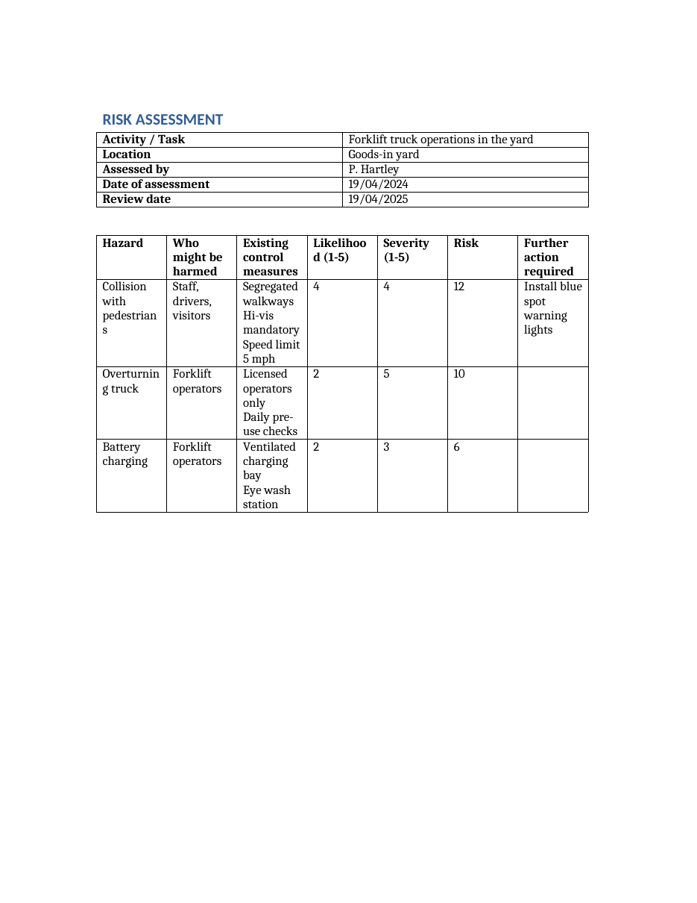
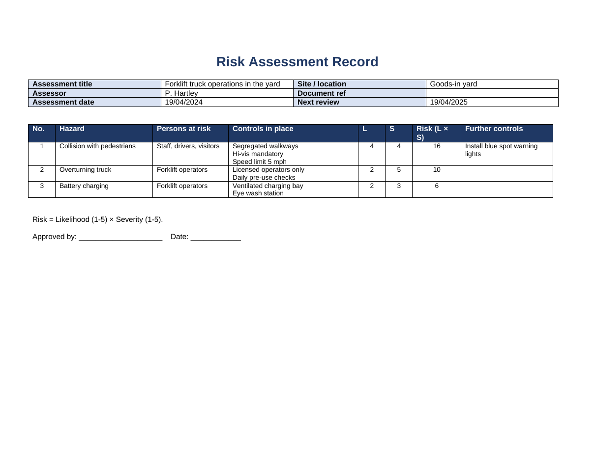

# Risk assessment migration: old Word layout to a new macro-enabled template

A Python tool for a common document job: a set of Word documents has to be moved into a new
template, saved as macro-enabled `.docm`, with the same file names, and with calculated values
checked along the way.

This is a demonstration project. The five risk assessments and the template are invented and
generated by `make_samples.py`.

| Before (old layout) | After (new template) |
|---|---|
|  |  |

## What it does

- Starts every document from the template file, so the template's layout, styles and any
  macros are carried over and only the field values are filled in.
- Moves each detail into the matching field, even where the label has changed
  ("Assessed by" becomes "Assessor").
- Adds one table row per hazard by copying the template's own row, so added rows keep its
  formatting.
- Calculates Risk = Likelihood × Severity for every hazard.
- Saves each file as `.docm` under the same name as the original.
- Re-opens every saved file and compares it with its source, then writes
  `migration_checklist.xlsx` listing what a person should look at.

## What it catches

In the sample set, two of the five documents are flagged for review:

| Document | Flag |
|---|---|
| RA-003 Forklift Operations | Old document said 12, but 4 × 4 = 16; 16 used |
| RA-005 Cleaning Chemicals | Severity is missing, so the risk score is left blank |

Nothing is guessed: a missing value stays blank and is reported.

## Limits

- The sample template contains no macros, because it is generated without Word. The tool
  keeps every part of the template file, and checks that a macro project is unchanged when
  one is present, but that path has not been exercised on a real macro-enabled template here.
- Text is carried over paragraph by paragraph. Bold or italic applied to individual words
  inside an old cell is not preserved.
- Outputs should still be opened in Word for a final visual check.

## Run it

```bash
python make_samples.py
```

```bash
python migrate.py
```

```bash
python -m pytest -q
```

Requires Python 3.10+, `python-docx` and `openpyxl`.

## Layout

- `old/`: the original documents
- `template/`: the new macro-enabled template
- `new/`: converted documents and `migration_checklist.xlsx`
- `preview/`: before and after images
